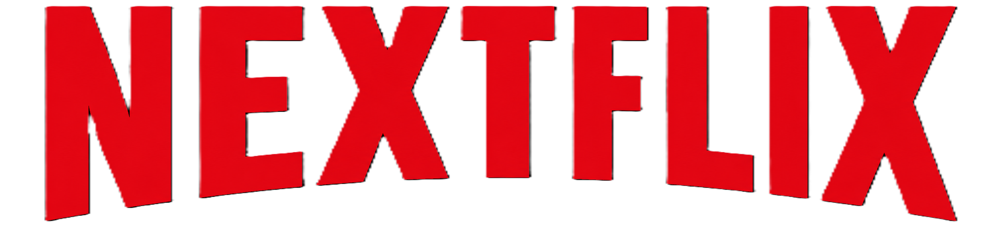

# 🎬 NEXTFLIX — High-Fidelity Netflix Clone

<div align="center">

  

  <p><strong>A pixel-perfect, fully interactive Netflix streaming experience built with pure Vanilla HTML5, CSS3, and Modern JavaScript.</strong></p>

  <p>
    <a href="https://vercel.com/new/clone?repository-url=https%3A%2F%2Fgithub.com%2Falokroushan%2Fnext">
      
    </a>
  </p>

  <p>
    
    
    
    
    
  </p>

</div>

---

## 🌟 Overview

**NEXTFLIX** is a full-featured web recreation of the modern Netflix platform. It faithfully recreates the signature Netflix aesthetic: dark obsidian themes, cinematic video hero banners, interactive content rows, multi-profile account switcher, and an embedded video player — all engineered with **zero external frameworks or heavy dependencies**.

Ready for instant one-click deployment on **Vercel**, GitHub Pages, or any static hosting platform.

---

## ✨ Features

### 1. 🏠 Landing Experience (`index.html`)
- **Cinematic Hero**: Autoplaying background video preview with radial and linear gradient vignette overlays.
- **Top 10 Trending Carousel**: Large numbered rank cards with smooth horizontal scroll navigation.
- **Movie Detail Modal**: Click on any title to view tags, synopsis, release year, and maturity rating.
- **FAQ Accordion**: Expandable Q&A section matching Netflix India's landing format.
- **Floating Input Email CTA**: Interactive email onboarding form with instant regex validation.

### 2. 🔐 Authentication Flow (`signup.html`)
- **Dual-Mode System**: Seamlessly switch between **Sign In** and **Get Started (Sign Up)**.
- **Client-Side Validation**: Checks for email/phone format with friendly feedback states.
- **Session Persistence**: Saves authentication and profile credentials into `localStorage`.
- **Collapsible Help Drawer**: Expandable troubleshooting links and Google reCAPTCHA notice.

### 3. 🍿 Streaming Dashboard (`home.html`)
- **Sticky Navigation Bar**: Dynamic backdrop blur and dark scroll transitions with quick links.
- **Live Search**: Client-side filtering across movie titles, tags, and genres.
- **Multi-Profile Manager**:
  - Switch between profiles (Personal, Guest, Teens, Kids).
  - Add new custom profiles with personalized initials and vibrant avatar color tones (`ocean`, `sunset`, `violet`, `mint`).
  - Saved automatically to `localStorage`.
- **Hero Feature Banner**:
  - Featured movie preview with live background video playback.
  - Interactive audio toggle (Mute / Unmute).
  - Quick "Play" and "More Info" action triggers.
- **Interactive Content Rows**:
  - 🔄 **Continue Watching**: Real-time progress bars and "Remove from list" actions.
  - 🏆 **Top 10 Movies in India Today**: Distinct ranked badges.
  - 🔥 **Trending Now**: Reverse-curated catalog.
  - 🌸 **Acclaimed Anime Masterpieces**: Curated collection with custom thumbnails.
  - 💖 **Heartfelt Romance & Drama**: Emotional favorites.
  - 📌 **My List**: Add or remove any movie with instant feedback and toast notifications.
- **Full Video Player Modal**:
  - In-browser HTML5 video player with custom control overlay.
  - Skip forward/backward by 15 seconds.
  - Variable playback speed selector (`0.5x`, `0.75x`, `1.0x`, `1.25x`, `1.5x`, `2.0x`).
  - Add/remove directly from My List while watching.

---

## 🚀 How to Host on Vercel

Hosting NEXTFLIX on Vercel takes less than a minute. You have two easy options:

### Option A: Via Vercel Web Dashboard (Recommended)

1. Go to [vercel.com](https://vercel.com/) and sign in with your GitHub account.
2. Click **"Add New..."** &rarr; **"Project"**.
3. Import your repository: `alokroushan/next`.
4. Configure the Project:
   - **Framework Preset**: `Other`
   - **Root Directory**: `./` (leave default)
   - **Build & Development Settings**: Leave blank (no build command needed).
5. Click **"Deploy"**.
6. Your site will be live within seconds at `https://next-<your-username>.vercel.app`! 🎉

### Option B: Deploy Using Vercel CLI

If you prefer using the terminal:

```bash
# 1. Install Vercel CLI globally (if not already installed)
npm install -g vercel

# 2. Log in to Vercel
vercel login

# 3. Deploy
vercel

# 4. Deploy to production
vercel --prod
```

### ⚡ Vercel Routing Configuration (`vercel.json`)

The repository includes a preconfigured `vercel.json` for clean routing:

```json
{
  "$schema": "https://openapi.vercel.sh/vercel.json",
  "cleanUrls": true,
  "trailingSlash": false,
  "rewrites": [
    { "source": "/browse", "destination": "/home.html" },
    { "source": "/home", "destination": "/home.html" },
    { "source": "/signup", "destination": "/signup.html" },
    { "source": "/signin", "destination": "/signup.html?mode=signin" }
  ]
}
```

This ensures that:
- `/` renders the landing page (`index.html`).
- `/browse` and `/home` seamlessly serve the streaming dashboard (`home.html`).
- `/signup` and `/signin` route to the authentication page (`signup.html`).

---

## 💻 Local Development

To run this project locally on your machine:

### Method 1: VS Code Live Server
1. Clone the repository:
   ```bash
   git clone https://github.com/alokroushan/next.git
   cd next
   ```
2. Open in VS Code:
   ```bash
   code .
   ```
3. Right-click `index.html` and click **"Open with Live Server"**.

### Method 2: Python Simple HTTP Server
```bash
# In the project directory:
python -m http.server 3000
# Open http://localhost:3000 in your browser
```

### Method 3: Node `npx serve`
```bash
npx serve .
# Open the displayed localhost URL
```

---

## 📁 Repository Structure

```text
next/
├── images/                           # Graphic assets, posters, video preview
│   ├── gemini_generated_video_35d56ebe.mp4 # Hero background video
│   ├── nextflix-logo.png             # NEXTFLIX signature red logo
│   ├── hero-bg.jpg                   # Hero fallback poster
│   ├── silent-voice.jpg              # Movie thumbnail
│   ├── your-name.jpg                 # Movie thumbnail
│   ├── weathering-with-you.jpg       # Movie thumbnail
│   ├── garden-of-words.jpg           # Movie thumbnail
│   ├── josee-tiger-fish.jpg          # Movie thumbnail
│   ├── pancreas.jpg                  # Movie thumbnail
│   ├── grave-of-the-fireflies.jpg    # Movie thumbnail
│   ├── spirited-away.jpg             # Movie thumbnail
│   ├── suzume.jpg                    # Movie thumbnail
│   ├── anohana.jpg                   # Movie thumbnail
│   └── ...                           # Icons & reasons illustrations
├── .gitignore                        # Git ignore rules
├── favicon.ico                       # Favicon
├── home.css                          # Stylesheet for browse dashboard & player
├── home.html                         # Main streaming dashboard & browse screen
├── index.html                        # Public landing page with FAQ & Top 10
├── README.md                         # Project documentation
├── script.js                         # Core JavaScript (modal, carousel, auth validation)
├── signup.html                       # Sign in & membership setup screen
├── styles.css                        # Global styling & landing page styles
└── vercel.json                       # Vercel deployment rewrites & cleanUrls config
```

---

## 🛠️ Tech Stack

| Technology | Purpose |
| :--- | :--- |
| **HTML5** | Semantic layout, embedded `<video>` API, accessible dialogs & forms |
| **CSS3** | Flexbox, CSS Grid, custom scrollbars, animations, responsive design |
| **Vanilla JavaScript (ES6+)** | State management, dynamic DOM rendering, localStorage persistence |
| **Vercel** | Edge global CDN static site hosting |

---

## 📄 License

This project is created for educational and portfolio demonstration purposes. All movie titles, posters, and imagery belong to their respective copyright holders and Studio creators.

---

<div align="center">
  <sub>Engineered with ❤️ by <a href="https://github.com/alokroushan">Alok Roushan</a></sub>
</div>
